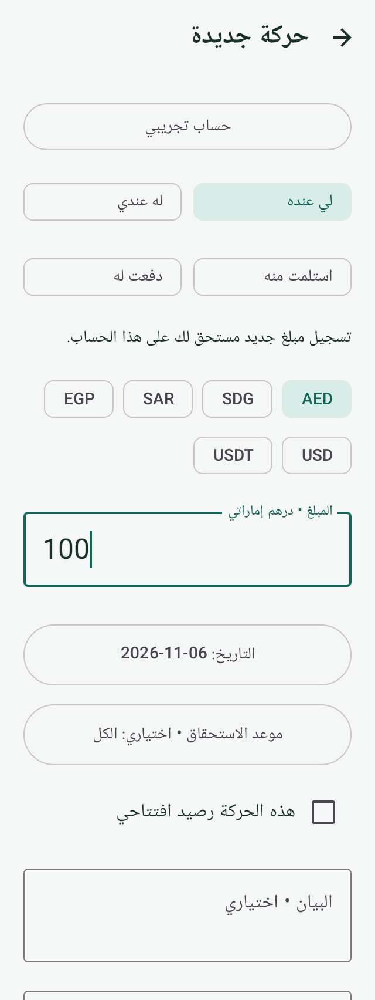
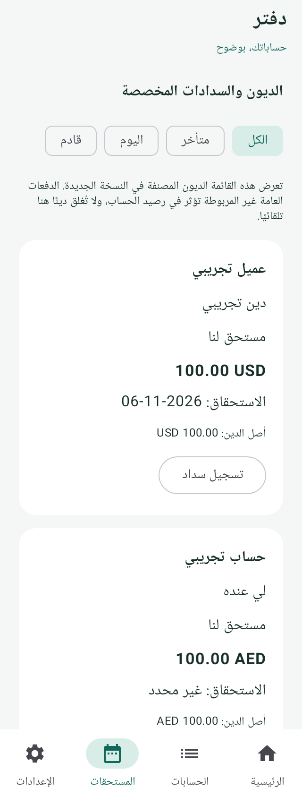
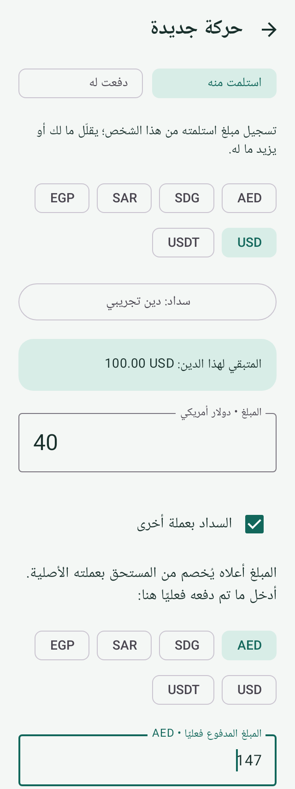

# دفتر — Account App

تطبيق أندرويد عربي بسيط لحسابات الأشخاص والجهات، من مشروع Ammar Gais.

**[تحميل APK الإصدار 0.2.0](https://github.com/ammargais/Account-App/releases/download/v0.2.0-preview/Daftar_0.2.0.apk)** · [صفحة الإصدارات](https://github.com/ammargais/Account-App/releases)

على الهاتف حمّل `Daftar_0.2.0.apk` من Assets ثم افتحه للتثبيت. ملفات Source code ليست التطبيق. Android 8.0 أو أحدث. إصدار تجريبي؛ [تفاصيل التحديث والتثبيت](docs/RELEASE_0.2.md).

## الاستخدام

1. أضف حساب الشخص أو الجهة وحدد تصنيفه إن أردت.
2. اختر **لي عنده / له عندي / استلمت منه / دفعت له**، ثم العملة والمبلغ.
3. لسداد دين محدد، افتح **المستحقات ← تسجيل سداد**. يمكن الدفع جزئيًا وبعملة أخرى.
4. من حساب الشخص احفظ أو شارك كشف PDF أو CSV. ومن الإعدادات فعّل النسخ الاحتياطي والقفل إن رغبت.

مثال: لك عند أحمد 100 USD. ربط سداد 40 USD بالدين، مع دفع فعلي 147 AED، يترك 60 USD مستحقة لك. يُحفظ مبلغ الدفع وسعره دون إنشاء دين بالدرهم. حسابات AED وSDG وSAR وEGP وUSD وUSDT مستقلة، ولا يفترض التطبيق تكافؤ USD وUSDT.

## المزايا

- رصيد افتتاحي، معاينة قبل الحفظ، تصنيف الحسابات والمفضلة والبحث، مرجع إشعار أو حجز.
- استحقاقات وسدادات مخصصة؛ تنبيه اختياري عند موعد السداد وتحذير تكرار الحركة مع إمكانية التأكيد.
- صور/PDF مرفقة، حتى 5 ملفات للحركة و10 ميغابايت لكل ملف.
- كشف عربي متعدد الصفحات بأرصدة البداية والحركات والنهاية لكل عملة؛ حفظ ومشاركة PDF وCSV.
- قيود محفوظة محليًا في SQLite؛ تصحيح بعكس الحركة مع السبب، وأرشفة بدل حذف الحساب.
- نسخ مشفرة AES-256-GCM وPBKDF2 تشمل المرفقات؛ استعادة بدمج يمنع تكرار المعرفات؛ قبول نسخ JSON القديمة.
- نسخ آلي اختياري يومي وبعد التغييرات إلى مجلد تختاره؛ ملفات منفصلة وآخر نجاح/فشل ظاهر. كلمة النسخ الآلي محفوظة باستخدام Android Keystore.
- قفل ببصمة أو رمز الجهاز؛ واجهة عربية؛ دون تسجيل دخول أو إعلانات أو إذن إنترنت.

## الحدود

دفتر ذمم مبسط؛ الصناديق والبنوك والإيرادات والمصروفات والأرباح مرحلة منفصلة. القيود متوازنة داخل كل عملة عبر حساب مقابل داخلي، لكنه ليس دفتر صناديق أو قوائم مالية. لا تحويل أموال أو ربط بنكي أو مزامنة بين الأجهزة أو أسعار تلقائية.

المستحقات تعرض الديون المصنفة في النسخة الجديدة. الحركات القديمة والدفعات العامة وتبديل عملة رصيد تؤثر في صافي الحساب، ولا تخصص تلقائيًا لدين؛ راجع صافي الحساب مع المستحقات. عند تصحيح دين مرتبط بدفعات، اعكس الدفعات أولًا.

النسخ والتذكيرات الآلية تخضع لقيود بطارية أندرويد. مزود الملفات قد لا يدعم اختيار مجلد؛ نجاح الكتابة لا يؤكد اكتمال المزامنة السحابية. احتفظ بكلمة مرور النسخ؛ لا يوجد استرداد لها. يُنصح بتجربة الاستعادة على بيانات تجريبية قبل الاعتماد اليومي.

## البناء والتحقق

JDK 17، Android SDK 36، Build Tools 35.0.0، Gradle 8.13.

```sh
./gradlew testDebugUnitTest lintDebug assembleDebug
./gradlew connectedDebugAndroidTest
```

المبالغ أعداد صحيحة دقيقة `BigInteger`؛ العملات النقدية بمنزلتين وUSDT بست منازل كقرار منتج، دون `Float/Double` للأرصدة. اختبارات JVM/SQLite/واجهة Robolectric، واختبارات جهاز لـ PDF وKeystore. [سجل التحقق وحدوده](docs/VALIDATION.md).

لتوقيع إصدار المالك اضبط `DAFTAR_SIGNING_STORE` و`DAFTAR_SIGNING_STORE_PASSWORD` و`DAFTAR_SIGNING_KEY_ALIAS` و`DAFTAR_SIGNING_KEY_PASSWORD`، ثم `./gradlew assembleRelease`. المفاتيح لا توجد في المستودع. CI يتحقق من ملف المالك الموقع المحفوظ في فرع `distribution` ثم يرفقه بإصدار GitHub بعد اجتياز الفحوص؛ ملف debug الخاص بـ CI للمطورين فقط.

[نطاق التحديث](docs/UPGRADE_0.2.md) · [المراجع وخطة المنتج](docs/PRODUCT_AND_RESEARCH.md)

## معاينة

صور اختبار ببيانات اصطناعية من التطبيق عبر Robolectric، وليست من هاتف المستخدم:

  
