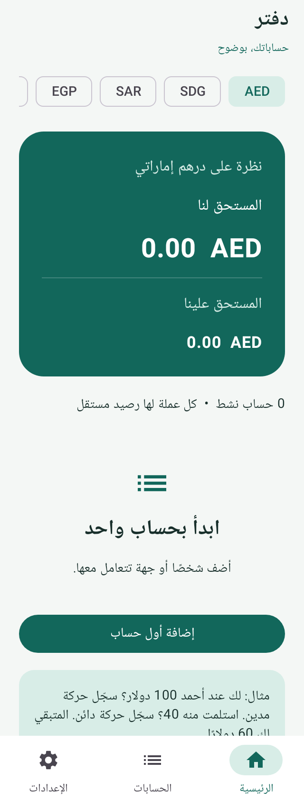
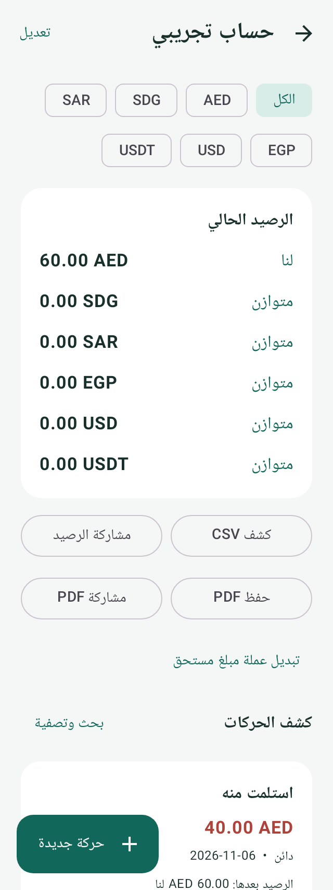

# دفتر — Account App

تطبيق أندرويد عربي بسيط لتسجيل المبالغ المستحقة بين صاحب الدفتر والأشخاص أو الجهات. مشروع Ammar Gais.

## الوظائف

- حساب واحد للشخص مع أرصدة منفصلة في AED وSDG وSAR وEGP وUSD وUSDT.
- مدين «لنا» ودائن «علينا»، معاينة الرصيد قبل الحفظ، تاريخ وبيان ومرجع ورصيد افتتاحي.
- لوحة تلخّص المستحق لنا والمستحق علينا لكل عملة، دون مقاصة أرصدة الأشخاص المختلفين.
- كشف حساب ببحث وفترة وعملة ورصيد متحرك، تصدير CSV بترميز UTF-8 يفتح في Excel، ومشاركة ملخص الرصيد عبر تطبيقات الجهاز.
- تبديل عملة مبلغ مستحق بإدخال المبلغ الأصلي والمبلغ البديل فعليًا. يحتفظ القيد بالمبلغين ولا يفترض سعرًا بين USD وUSDT.
- عكس الحركة مع سبب التصحيح مع بقاء الأصل؛ أرشفة الحساب بدل حذفه.
- حفظ تلقائي محلي في SQLite، ونسخ JSON يدوية إلى المكان الذي يختاره المستخدم، مع استعادة بالدمج ومنع تكرار المعرفات.
- واجهة عربية من اليمين إلى اليسار، دون تسجيل دخول أو إعلانات أو إذن إنترنت.

## مثال

لك عند أحمد 100 USD: أدخل **مدين** بقيمة 100. استلمت منه 40 USD: أدخل **دائن** بقيمة 40. الرصيد: **60 USD لنا**. إذا كان لك عنده أيضًا 50 AED يظهر رصيد مستقل، ولا يُجمع مع الدولار.

المعاني هنا تخص حسابات الأشخاص من منظور صاحب الدفتر؛ ليست تعميمًا لمعنى المدين والدائن في جميع أنواع الحسابات المحاسبية.

## الحدود المقصودة للنسخة 0.1.0

هذا دفتر ذمم مبسّط، وليس نظام قوائم مالية كاملًا. هناك طرف مقابل داخلي لموازنة الحركات داخل كل عملة، لكنه ليس تصنيفًا للإيرادات والمصروفات أو للصناديق. لا تُستنتج منه أرباح أو ضرائب أو ميزانية نظامية. لا يوجد تحويل عملات تلقائي أو ربط بنكي أو تحويل أموال أو مزامنة بين أجهزة.

ملف النسخة الاحتياطية غير مشفر؛ احفظه في مكان خاص. إلغاء تثبيت التطبيق يحذف قاعدة بيانات الجهاز؛ خذ نسخة خارجية أولًا. ظهور Google Drive في منتقي الملفات يعتمد على مزود الملفات المثبت؛ نجاح الكتابة لا يثبت اكتمال المزامنة مع السحابة.

## التشغيل والبناء

- Android 8.0 (API 26) أو أحدث.
- JDK 17، Android SDK 36، Build Tools 35.0.0.
- Kotlin 2.2.21، AGP 8.13.2، Gradle 8.13، Jetpack Compose / Material 3.

```sh
./gradlew testDebugUnitTest lintDebug assembleDebug
```

المخرج: `app/build/outputs/apk/debug/app-debug.apk`.

البناء الحالي debug للتجربة. اعتماد إصدار توزيع مستقر يحتاج مفتاح توقيع خاص محفوظ لدى مالك المشروع؛ لا تودع مفاتيح التوقيع في GitHub ولا تبدّل التوقيع بين تحديثات التطبيق.

## البنية

- `core/`: حسابات المبالغ، دفتر القيود، قواعد التحقق، الكشوف، تنسيق النسخ.
- `data/LedgerDb.kt`: تخزين SQLite ذري مع منع حذف أو تغيير حركة سابقة.
- `AccountViewModel.kt`: حالة الشاشة والعمليات خارج الخيط الرئيسي.
- `MainActivity.kt`: الشاشات العربية ومسارات تسجيل الحسابات والحركات والتصدير.
- اختبارات JVM للحسابات والاستعادة والحفظ في قاعدة البيانات.

المبالغ أعداد صحيحة دقيقة للوحدات الصغرى باستخدام `BigInteger`؛ العملات النقدية بمنزلتين عشريتين وUSDT بست منازل كقرار منتج لهذه النسخة، دون استخدام `Float/Double` للأرصدة. الدقة ليست اتصالًا بشبكة بلوكشين.

انظر [مراجعة التطبيقات والمراجع وخطة التطوير](docs/PRODUCT_AND_RESEARCH.md) و[فحص النسخة](docs/VALIDATION.md).

## معاينة من التطبيق

صور محاكاة ببيانات تجريبية، وليست صورًا من هاتف المستخدم:

  
